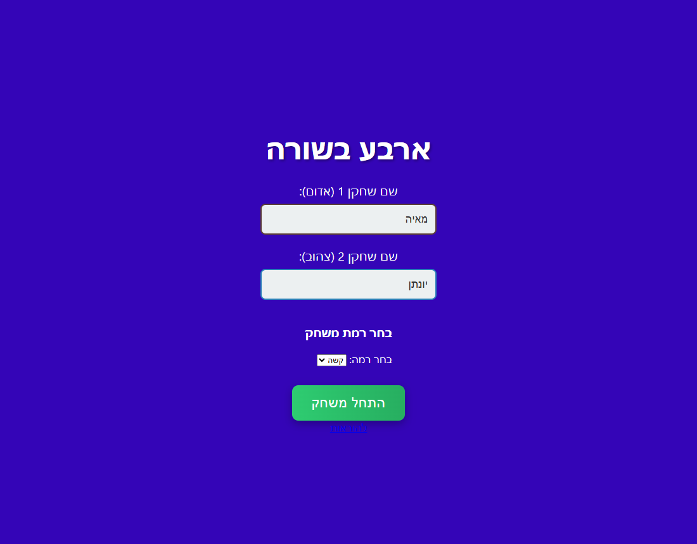
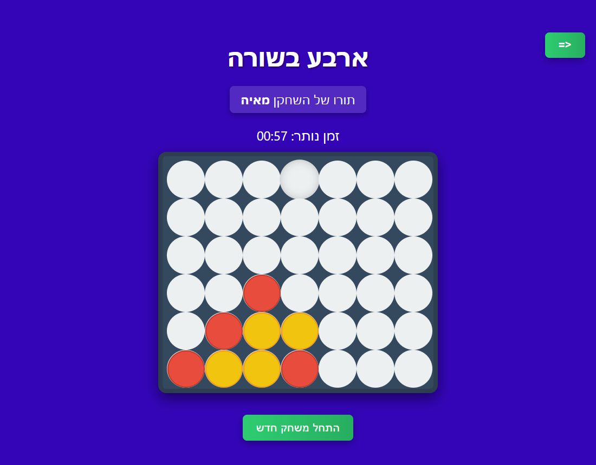
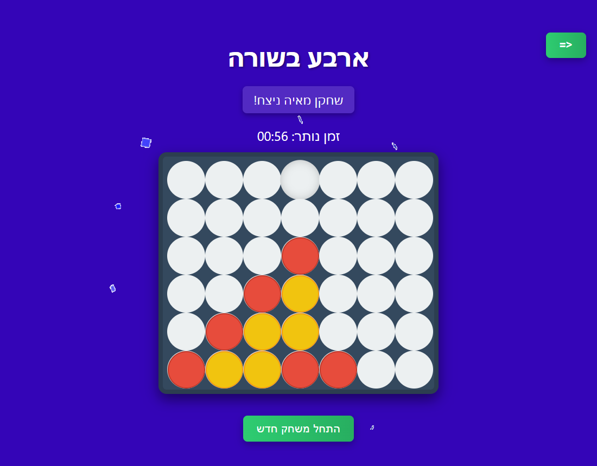
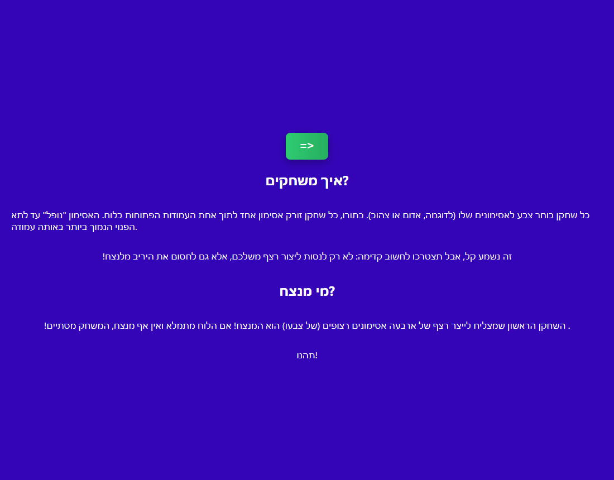

# 🔴🟡 ארבע בשורה — Connect Four

משחק **ארבע בשורה** לשני שחקנים, שנבנה ב-**HTML, CSS ו-JavaScript טהור**: בלי ספריות חיצוניות, בלי שרת ובלי התקנה.
שני שחקנים מתחרים על לוח של 7 עמודות × 6 שורות. כל שחקן בוחר עמודה, האסימון "נופל" לתא הפנוי התחתון, והראשון שיוצר רצף של ארבעה אסימונים מנצח.

**שפות:** HTML5 · CSS3 · JavaScript

---

## 🎬 סרטון הדגמה (פחות מדקה)

משחק אמיתי עם הסבר קולי בעברית: איך האסימון נופל, איך הלוח נשמר, ואיך המשחק בודק ניצחון בכל הכיוונים.

https://github.com/user-attachments/assets/d023c1fc-41a1-411d-98a2-91a6b008efa9

---

## 📸 צילומי מסך

| הגדרת שחקנים ורמת קושי | באמצע משחק (רמה קשה, עם טיימר) |
|:---:|:---:|
|  |  |
| **ניצחון: ארבעה באלכסון + קונפטי** | **דף ההוראות** |
|  |  |

---

## ✨ עיקרי הפרויקט

- **הלוח הוא מטריצה:** כל תא מסומן ריק / אדום / צהוב, והתצוגה נבנית ממנה דינמית ב-JavaScript.
- **כוח משיכה:** לחיצה על עמודה סורקת אותה מלמטה למעלה, והאסימון נוחת בתא הפנוי הנמוך ביותר עם אנימציית נפילה.
- **בדיקת ניצחון חכמה:** המשחק לא סורק את כל הלוח. הוא בודק רק סביב האסימון האחרון, בארבעה צירים (אופקי, אנכי ושני אלכסונים), וסופר כמה אסימונים רצופים באותו צבע יש בכל ציר.
- **שתי רמות קושי:** ב"קל" אין הגבלת זמן, וב"קשה" יש טיימר של 60 שניות.
- **מעבר נתונים בין דפים:** השמות ורמת הקושי נשמרים ב-`localStorage`.
- **קובץ JS אחד לכל הדפים:** הקוד מזהה באיזה דף הוא נמצא לפי האלמנטים שקיימים ב-DOM.

---

## ▶️ איך מריצים

מורידים את הפרויקט ופותחים את `beforeHomePage.html` בדפדפן (Chrome, Firefox או Edge). אין צורך בהתקנה, ב-build או בשרת.

---

## 📁 מבנה הפרויקט

```
FourInARow/
├── beforeHomePage.html   ← נקודת הכניסה: הגדרת שחקנים ורמת קושי
├── homePage.html         ← דף המשחק: הלוח, סטטוס, טיימר
├── rules.html            ← כללי המשחק
├── Script.js             ← כל הלוגיקה (משותף לכל הדפים)
├── Style.css             ← עיצוב משותף לכל הדפים
├── images/               ← רקע קונפטי בניצחון
└── docs/screenshots/     ← צילומי המסך של ה-README
```

## 🔄 זרימת המשחק

```
beforeHomePage.html
        │  הזנת שמות + בחירת קושי + "התחל משחק"
        │  שמירה ב-localStorage
        ▼
   homePage.html  ◄──── rules.html (קישור "להוראות")
        │  לחיצה על עמודות → הטלת אסימונים
        │  בדיקת ניצחון / לוח מלא / סיום זמן
        ▼
   סיום משחק  →  "התחל משחק חדש" / חזרה לדף הכניסה
```

---

## 🧠 איך זה עובד

### מודל הנתונים

הלוח מיוצג במערך דו-ממדי `board[ROWS][COLS]` (`ROWS = 6`, `COLS = 7`):

| ערך | משמעות |
|-----|---------|
| `0` | תא ריק |
| `1` | אסימון שחקן 1 (אדום) |
| `2` | אסימון שחקן 2 (צהוב) |

משתני מצב: `currentPlayer` (מי בתור), `gameOver`, `player1Name` / `player2Name`, `gameDifficulty`.

### מהלך: `handleCellClick()`

1. העמודה נלקחת מה-`dataset` של התא שנלחץ.
2. סריקה מלמטה למעלה מוצאת את התא הריק הראשון. אם העמודה מלאה, לא קורה כלום.
3. `board[row][col] = currentPlayer`, ונוצר אסימון עם אנימציית נפילה.
4. **בדיקת ניצחון**, ואז **בדיקת לוח מלא**.
5. אם המשחק ממשיך, התור עובר לשחקן השני.

### בדיקת ניצחון: `checkWin()` + `countConsecutive()`

אחרי כל מהלך נבדק רק האסימון שהונח, בארבעה צירים:

| ציר | כיוונים (`dRow`, `dCol`) |
|--------|----------------|
| אופקי | `(0, 1)` + `(0, -1)` |
| אנכי | `(1, 0)` (מתחת בלבד, כי מעל האסימון האחרון אין כלום) |
| אלכסון ↘ ↖ | `(1, 1)` + `(-1, -1)` |
| אלכסון ↙ ↗ | `(1, -1)` + `(-1, 1)` |

`countConsecutive()` סופרת אסימונים רצופים של אותו שחקן בכיוון נתון, בלי לחרוג מגבולות הלוח.
ניצחון כאשר: `1 + count(כיוון1) + count(כיוון2) >= 4`.

### טיימר (רמה קשה)

ספירה לאחור של 60 שניות עם `setInterval`, בתצוגת `MM:SS`. כשמגיעים ל-0, המשחק מסתיים בהודעה "נגמר הזמן!".

### תנאי סיום

1. **ניצחון:** ארבעה ברצף (אופקי, אנכי או אלכסוני), עם רקע קונפטי.
2. **לוח מלא:** כל 42 התאים תפוסים ואין מנצח.
3. **נגמר הזמן:** ברמה קשה בלבד.

### עיצוב: `Style.css`

- הלוח בנוי ב-**CSS Grid** של 7 × 6 תאים עגולים, עם אפקט hover.
- האסימונים נופלים באנימציה של `transform` + `transition`.
- הצבעים: אדום `#e74c3c`, צהוב `#f1c40f`.

---

## 📚 מה נלמד בפרויקט

- בניית ממשק דינמי עם `document.createElement` ו-`appendChild`
- ניהול מצב משחק במטריצה דו-ממדית
- Event listeners על אלמנטים שנוצרים בזמן ריצה, ושימוש ב-`dataset`
- אלגוריתם בדיקת ניצחון בכמה כיוונים
- שמירת נתונים בין דפים עם `localStorage`
- טיימר עם `setInterval` / `clearInterval`
- CSS Grid, transitions ואנימציות
- ארכיטקטורת multi-page עם קובץ JS משותף
